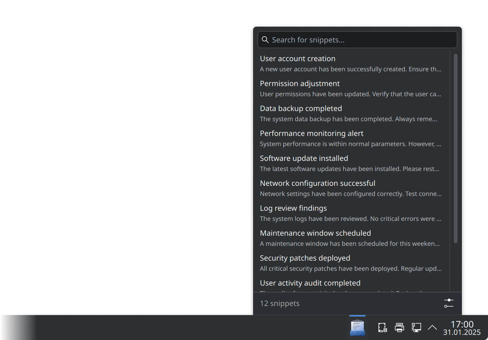

# Kopypast

_Kopypast_ is a KDE Plasma applet for quick interaction with text snippets.

  
  
  

## Building from source

The recommended method is to use KPackage Manager:

1. Install the package that provides the `kpackagetool6` command in your distribution.
2. Clone `https://github.com/vmkspv/kopypast.git` repository and `cd kopypast`.
3. Run `kpackagetool6 -t Plasma/Applet --install package` command.

After installation, the applet should be available to add to your Plasma panels/desktop via the widget browser.

## Contributing

**This project is archived and no longer accepting contributions**.

If you'd like to continue development, feel free to fork this repository.

> This project follows the [KDE Community Code of Conduct](https://kde.org/code-of-conduct).

## License

Kopypast is released under the [GPL-3.0 license](COPYING).
